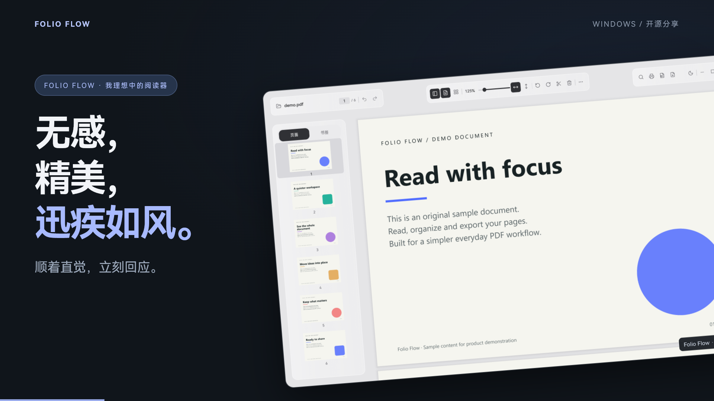
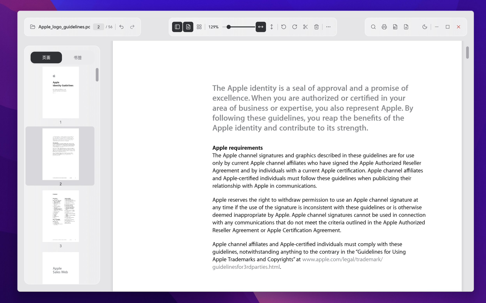
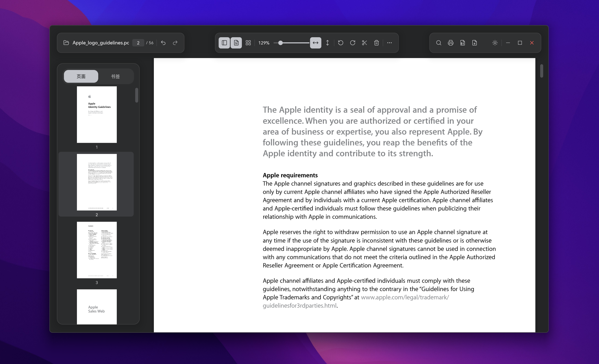
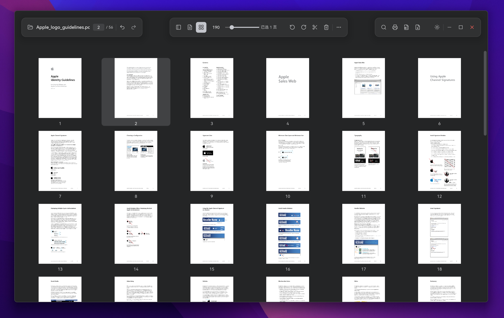

# Folio Flow

[简体中文](README.md) · **English**

**Read with focus. Organize with flow.**

Folio Flow is a Rust-powered PDF reader and page editor for Windows. Built on [the original Folio](https://github.com/Dethon/folio), it **completely redesigns the UI and interaction experience**: floating toolbars, page navigation, a page organizer, light and dark themes, dialogs, and drag-and-drop feedback.

A lightweight interface, direct controls, and carefully tuned motion. Open a document, settle into reading, arrange its pages, and export what you need—all in one considered workspace.

## Watch the demo

**Quiet by design. Beautiful in detail. Swift in motion.** See how Folio Flow brings reading, page organization, and responsive interactions into one fluid workspace.

[](https://www.bilibili.com/video/BV13N1Jz6EfG/)

[▶ Watch the full demo on Bilibili](https://www.bilibili.com/video/BV13N1Jz6EfG/) · Chinese narration

## A new interface, designed for focus

- **Two themes, fully considered.** The light theme combines glass-like edges with soft shadows. The dark theme balances deep space gray surfaces, panels, and highlights, keeping the document at the center of attention.
- **Floating tools within reach.** File, reading, and page-editing controls have distinct groups, consistent icons, rounded corners, and clear state feedback.
- **Carefully tuned interaction animations.** Neighboring pages make room as you drag; insertion previews follow the pointer; edges scroll automatically. Panels and dialogs share a consistent transition rhythm, making every movement and drop position clear.
- **Reading and organizing, connected.** Switch between thumbnail navigation and the page overview. Reorder, rotate, delete, undo, and redo—or drop an image or another PDF exactly where it belongs.
- **A Chinese-language app with flexible output.** Export Markdown, JPG, or PNG, and rewrite or rasterize PDFs through consistent dialogs. This English README documents the app; the application UI is currently Chinese.

### Light theme · Clear, airy, focused



### Dark theme · Clarity in deep space gray



### Page organizer · See the whole document



Screenshots show the running application. Sample document content and trademarks belong to their respective owners.

## Features

- **Reading and navigation:** Continuous scrolling, 10%–800% zoom, fit width or page, outline and thumbnail navigation, document links, and web and email links.
- **Search and selection:** Search as you type with highlighted matches, ignoring case and accents and handling phrases across lines and hyphenated words. Drag to select, double-click for a word, triple-click for a line, or copy all text.
- **Page editing:** Reorder, rotate, delete, and insert pages with undo/redo. Reordering reuses thumbnails, rotation refreshes changed pages, and deletion retains surviving caches.
- **Drop to insert:** Drop an image or PDF into the sidebar or organizer at the pointer position. PDFs insert all pages; one file is accepted per drop. Preview the position while hovering, commit on release.
- **Image handling:** PNG, JPG, WebP, BMP, GIF, and TIFF. Pages use 72 DPI (one pixel per PDF point), respect EXIF orientation, and flatten transparency to white. GIF/TIFF use the first image; import adds no extra lossy JPEG recompression.
- **Export:** Markdown, JPG, and PNG. **72 DPI is 1×**, with 1×, 1.5×, 2×, and 3× options and a pixel-size preview. Images are exported individually into a new folder using the current page order and rotations.
- **Compression:** Lossless rewriting or image-only PDFs. Raster mode offers 72/144/216 DPI and JPEG quality options, estimates size from sampled pages, and saves a copy. It preserves page appearance while removing text layers, links, bookmarks, and form data.
- **Save and print:** Save, save as, and prompts for unsaved changes; failed saves retain edits. Windows printing supports page ranges, includes current edits, and draws text and vector artwork directly through PDFium.

Markdown export handles headings, paragraphs, lists, emphasis, code, and ruled tables, removing recurring headers, footers, and page numbers. It also works from the command line:

```powershell
& '.\Folio Flow.exe' --export-markdown in.pdf out.md
& '.\Folio Flow.exe' --help
```

A dot before the filename indicates unsaved changes. Moving or deleting an imported source does not break redo. Dropping a PDF onto the reading canvas opens it as another document, prompting about unsaved changes first.

## Download and run

Visit [GitHub Releases](https://github.com/kelsoz/Folio-Flow/releases/latest) and download the latest `Folio-Flow-…-Windows-x64.zip`. Every push to `master` publishes a new release after cloud checks pass. Release assets are not subject to the 30-day Actions artifact retention period.

Extract the package and run **`Folio Flow.exe`**. Keep `pdfium.dll` and the license files beside it. The cloud workflow publishes a Windows x64 portable package and SHA-256 checksum; it does not generate an installer.

If you build an installer, run `Folio Flow-<version>-setup.exe`. It installs for the current user without administrator privileges and supports `/S` for silent installation. It adds Start menu and PDF “Open with” entries without changing the default reader. Uninstall through Windows Settings. The app is unsigned and may trigger a SmartScreen warning.

## Shortcuts

| Action | Shortcut |
|---|---|
| Open | Ctrl+O |
| Save / Save as | Ctrl+S / Ctrl+Shift+S |
| Undo / Redo | Ctrl+Z / Ctrl+Y or Ctrl+Shift+Z |
| Rotate left / right | Ctrl+Shift+R / Ctrl+R |
| Delete selected pages (organizer) | Delete |
| Print | Ctrl+P |
| Open export dialog | Ctrl+E |
| Find | Ctrl+F |
| Next / previous match | Enter / Shift+Enter, F3 / Shift+F3, or Ctrl+G / Ctrl+Shift+G |
| Close search bar | Esc |
| Copy / Select all / Clear selection | Ctrl+C / Ctrl+A / Esc |
| Zoom in / out / actual size | Ctrl++ / Ctrl+− / Ctrl+0; Ctrl+wheel to zoom |
| Reader: fit width / page | Ctrl+1 / Ctrl+2 |
| Organizer: return to reader / organizer | Ctrl+1 / Ctrl+2 |
| Toggle sidebar | Ctrl+B |
| Scroll | Wheel, arrows, PgUp / PgDn, Space, Home / End |

## Build locally

`rust-toolchain.toml` specifies the Rust version. On Windows, use PowerShell 7:

```powershell
pwsh -File scripts/fetch-pdfium.ps1
cargo fmt --check
cargo test --locked -- --test-threads=1
cargo clippy --locked --all-targets -- -D warnings
pwsh -File scripts/build-windows.ps1
& '.\dist\Folio Flow\Folio Flow.exe'
```

The script builds Release, copies PDFium and licenses, and checks Markdown export with paths containing spaces. Output is always `dist/Folio Flow/`; the internal Cargo target remains `folio`. PDFium is loaded at runtime and is not committed with the source.

Pushes to `master` trigger cloud checks, compilation, and Release publication. Manual runs are also supported. Tags use `v<package-version>-build.<run-number>.<attempt-number>` to preserve release history. Failed builds do not publish a public release.

Linux / WSL development and cross-compilation:

```sh
./scripts/fetch-pdfium.sh
cargo run --release -- path/to/file.pdf
cargo test
./scripts/package-windows.sh
```

Cross-packaging requires [cargo-xwin](https://github.com/rust-cross/cargo-xwin) and [NSIS](https://nsis.sourceforge.io), producing both a portable package and an installer. The installer is defined in `installer/folio.nsi`; set `PUBLISHER` to specify its publisher. After editing `assets/icon/folio.svg`, run `cargo run --example make-icon` to regenerate icons and installer artwork.

Further reference: [user guide (Chinese)](docs/USAGE.zh-CN.md) and [development notes (Chinese)](docs/DEVELOPMENT.md).

## Rendering and interaction architecture

Rendering uses [PDFium](https://pdfium.googlesource.com/pdfium/), the engine used in Chrome; the interface is powered by [Iced](https://iced.rs).

- One worker owns PDFium and schedules work for the current viewport. Stale requests are replaced, and completed results are received in batches per frame.
- Viewport-based tile rendering and virtualized page stacks, outlines, thumbnails, and organizer grids avoid building the entire document UI at once.
- Tiles, text layers, and thumbnails are cached. Document recycling, search, export, and printing preserve current unsaved edits.
- A shared conditional animation-frame subscription stops once motion settles. Search reuses extracted text; links reuse text-layer data.
- Windows defaults to Direct3D 12; `WGPU_BACKEND` overrides the backend. Drivers and hardware affect startup, memory, and frame behavior.

Historical benchmarks are available in [the upstream project](https://github.com/Dethon/folio); they do not describe current Folio Flow performance. Diagnostic entry points remain available (environment-variable syntax varies by shell):

```sh
FOLIO_TRACE=trace.txt folio book.pdf --screenshot shot.png
FOLIO_TRACE=trace.txt folio book.pdf --scroll-test 1500
folio --bench book.pdf
```

`FOLIO_TRACE` records startup timing; `FOLIO_TRACE_LOG=1` adds windowing and graphics library logs, with additional measurement overhead.

## Source map

| Path | Responsibility |
|---|---|
| `src/main.rs`, `src/app.rs` | Command line, application state, messages, and updates |
| `src/graphics.rs`, `src/trace.rs`, `src/bench.rs` | Graphics backend, diagnostics, and benchmarks |
| `src/engine/` | PDFium worker, text, links, Markdown, tables, images, and printing |
| `src/motion.rs` | Springs, tweens, and shared motion state |
| `src/ui/viewer.rs`, `sidebar.rs`, `organizer.rs` | Reading, navigation, and page organization |
| `src/ui/order.rs` | Stable page identities and edit history |
| `src/ui/chrome.rs`, `dialog.rs`, `theme.rs`, `icon.rs` | Toolbars, dialogs, themes, and icons |
| `src/web.rs` | Opening web and email links |
| `scripts/`, `installer/` | Builds, packaging, and installer |

## Current limitations

- Password-protected PDFs, annotation editing, and form filling are unsupported. Existing annotations can be displayed.
- Page-import rebuilding has limited preservation of signatures, forms, attachments, named destinations, and physical bookmark structures in complex PDFs. Rasterized PDFs preserve appearance only.
- Link navigation has no back history and does not follow links into other files. Recognition of plain-text URLs split across lines has limits.
- Search has no whole-word or regular-expression options, does not match across pages, and counts up to 20,000 results.
- Markdown table recognition requires drawn rules. Merged cells are flattened, tables spanning pages are exported separately, and images are not extracted. Scanned pages are not automatically OCRed.
- Printing outside Windows uses `lp`. The app and installer are unsigned.
- Real system drag-and-drop feel, DPI transitions, and current GUI performance still need on-device verification.

## License and credits

Based on [Folio](https://github.com/Dethon/folio), retaining the original attribution and [MIT license](LICENSE).

Thanks to PDFium (BSD-3-Clause / Apache-2.0), [bblanchon/pdfium-binaries](https://github.com/bblanchon/pdfium-binaries), [pdfium-render](https://github.com/ajrcarey/pdfium-render), Iced (MIT), and [Lucide](https://lucide.dev) icons (ISC).
