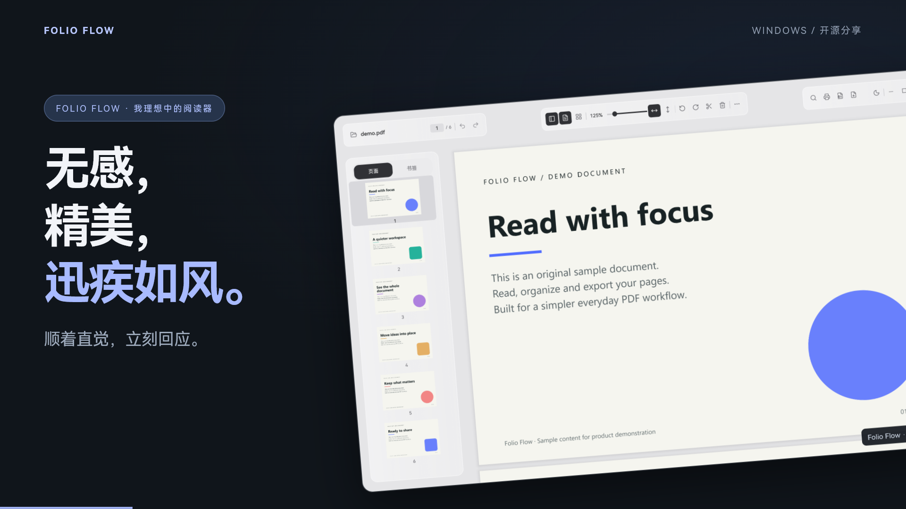
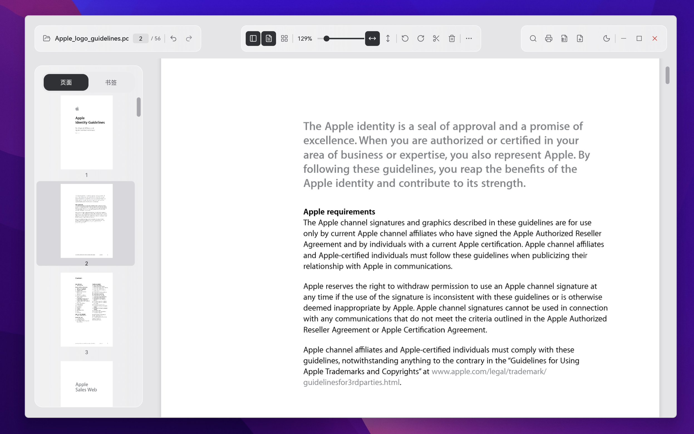
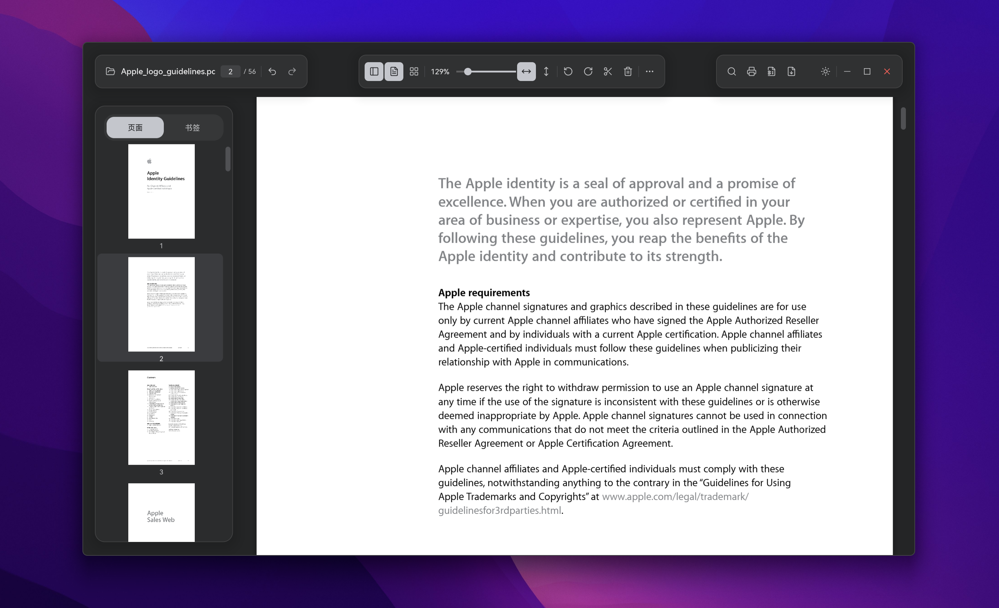
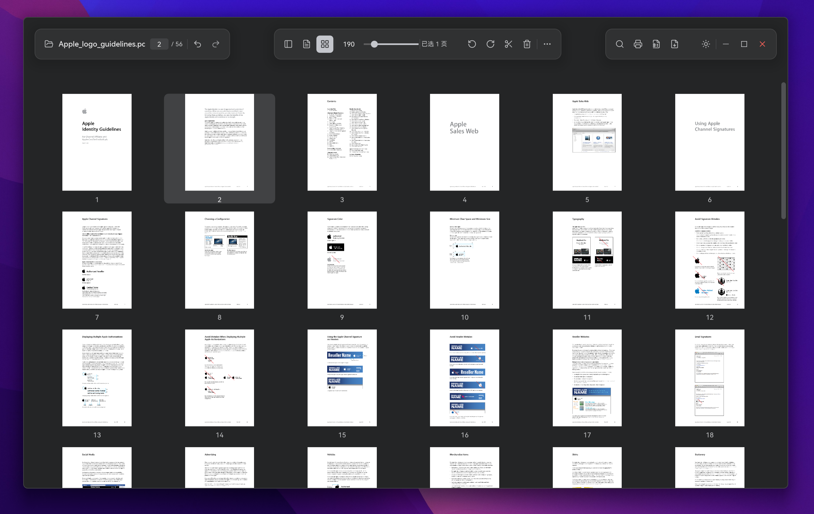

# Folio Flow

**简体中文** · [English](README.en.md)

**让阅读沉浸，让整理流动。**

Folio Flow 是一款基于 Rust 的 Windows PDF 阅读与页面编辑工具。在 [原版 Folio](https://github.com/Dethon/folio) 的基础上，**完整重构 UI 与交互体验**：从浮动工具栏、页面导航到页面编排，从亮暗主题到弹窗与拖放反馈，重新打磨每一处日常操作。

轻盈的界面，直接的操作，恰到好处的动效。打开文档、沉浸阅读、拖动整理，再以你需要的格式导出——让 PDF 工作流更顺手，也更赏心悦目。

## 演示视频

**无感，精美，迅疾如风。** 看看 Folio Flow 如何让阅读、页面整理与交互反馈连成流畅的工作体验。

[](https://www.bilibili.com/video/BV13N1Jz6EfG/)

[▶ 在 B 站观看完整演示](https://www.bilibili.com/video/BV13N1Jz6EfG/) · 中文配音

## 全新界面，为专注而设计

- **亮暗双主题，两种完整设计。** 亮色清透舒展，以细腻的玻璃质感边缘与柔和投影建立层次；暗色采用深空灰，精心平衡背景、面板与高光，让内容始终成为视觉中心。
- **浮动工具栏，功能触手可及。** 文件、阅读与页面编辑分组布局，统一图标、圆角和状态反馈，把常用操作放在自然的视线路径上。
- **精心调试的交互动画。** 拖动页面时相邻卡片自然让位，插入位置随光标实时呈现，靠近边缘自动滚动；面板与弹窗延续一致的过渡节奏。每一次移动都有回应，每一个落点都清楚可见。
- **从阅读到编排，一气呵成。** 缩略图导航与页面总览自由切换，支持拖动排序、旋转、删除及撤销重做；把图片或另一个 PDF 拖入指定位置，即可接入当前文档。
- **中文界面，完整输出。** Markdown、JPG、PNG 导出，以及 PDF 整理与纯图压缩，在统一的操作面板中完成。

### 亮色模式 · 清透、轻盈、专注



### 深色模式 · 深空灰中的清晰层次



### 页面编排 · 让整份文档尽在掌握



截图展示实际运行界面；示例文档中的内容与商标归各自权利人所有。

## 功能

- **阅读与导航：** 连续滚动、10%–800% 缩放、适合宽度或整页、书签与页面缩略图、文档内链接及网页和邮件链接。
- **搜索与复制：** 输入即搜索并高亮匹配，忽略大小写与重音，支持跨行词组和断词；拖动选择、双击选词、三击选行及复制全文。
- **页面编辑：** 排序、旋转、删除、插页，支持撤销重做。排序复用缩略图，旋转仅刷新变化页，删除保留幸存页缓存。
- **拖放插入：** 图片或 PDF 拖入导航栏、页面编排视图，按光标位置插入；PDF 插入全部页面，每次拖入一个文件。悬停预览位置，松手提交编辑。
- **图片处理：** 支持 PNG、JPG、WebP、BMP、GIF、TIFF，按 72 DPI（1 像素 = 1 点）生成页面，读取 EXIF 方向，透明部分铺白。GIF/TIFF 使用首幅图像；导入不额外进行 JPEG 有损重压缩。
- **导出：** Markdown、JPG、PNG。图片以 **72 DPI 为 1×**，可选 1×、1.5×、2×、3×，预览像素尺寸，每页单独输出到新文件夹。使用当前编辑后的页序与旋转。
- **压缩：** 无损整理或纯图 PDF；纯图模式提供 72/144/216 DPI 与 JPEG 质量选项，通过抽样快速预估文件大小，并保存为副本。纯图 PDF 仅保留页面外观，移除文字层、链接、书签与表单数据。
- **保存与打印：** 保存、另存为及未保存修改提醒；保存失败保留编辑结果。Windows 打印支持页码范围，使用当前编辑文档，文字和矢量图直接由 PDFium 绘制。

Markdown 导出支持标题、段落、列表、粗斜体、代码与有线表格，并过滤重复页眉、页脚和页码。也可使用命令行：

```powershell
& '.\Folio Flow.exe' --export-markdown in.pdf out.md
& '.\Folio Flow.exe' --help
```

文件名前的圆点表示尚未保存。导入后移动或删除原文件不会破坏重做。PDF 拖到阅读画布时会打开为另一文档，未保存时先确认。

## 下载与运行

前往 [GitHub Releases](https://github.com/kelsoz/Folio-Flow/releases/latest)，下载最新版本的 `Folio-Flow-…-Windows-x64.zip`。每次推送到 `master`，通过云端检查后都会自动发布一个新版本；Release 附件不受 Actions 构建产物 30 天保留期限影响。

解压后运行 **`Folio Flow.exe`**，请保留同目录的 `pdfium.dll` 和许可证文件。云端流程发布 Windows x64 便携包和 SHA-256 校验文件，不生成安装器。

若自行生成安装器，运行 `Folio Flow-<version>-setup.exe`，无需管理员权限，支持 `/S` 静默安装。安装器添加开始菜单及 PDF 打开方式入口，不自动替换默认阅读器；可在 Windows 设置中卸载。程序未签名，Windows 可能显示 SmartScreen 提示。

## 常用快捷键

| 操作 | 快捷键 |
|---|---|
| 打开 | Ctrl+O |
| 保存 / 另存为 | Ctrl+S / Ctrl+Shift+S |
| 撤销 / 重做 | Ctrl+Z / Ctrl+Y 或 Ctrl+Shift+Z |
| 左旋 / 右旋 | Ctrl+Shift+R / Ctrl+R |
| 删除选中页面（编排视图） | Delete |
| 打印 | Ctrl+P |
| 打开导出面板 | Ctrl+E |
| 搜索 | Ctrl+F |
| 下一个 / 上一个结果 | Enter / Shift+Enter，或 F3 / Shift+F3，或 Ctrl+G / Ctrl+Shift+G |
| 关闭搜索栏 | Esc |
| 复制 / 全选 / 清除选择 | Ctrl+C / Ctrl+A / Esc |
| 放大 / 缩小 / 原始大小 | Ctrl++ / Ctrl+− / Ctrl+0；Ctrl+滚轮缩放 |
| 阅读视图：适合宽度 / 整页 | Ctrl+1 / Ctrl+2 |
| 编排视图：返回阅读 / 页面编排 | Ctrl+1 / Ctrl+2 |
| 切换侧栏 | Ctrl+B |
| 沉浸模式 / 恢复工具栏 | Tab |
| 滚动 | 滚轮、方向键、PgUp / PgDn、空格、Home / End |

## 本地构建

Rust 版本由 `rust-toolchain.toml` 指定。Windows 使用 PowerShell 7：

```powershell
pwsh -File scripts/fetch-pdfium.ps1
cargo fmt --check
cargo test --locked -- --test-threads=1
cargo clippy --locked --all-targets -- -D warnings
pwsh -File scripts/build-windows.ps1
& '.\dist\Folio Flow\Folio Flow.exe'
```

构建脚本编译 Release，复制 PDFium 与许可证，并检查带空格路径下的 Markdown 导出。输出固定为 `dist/Folio Flow/`；Cargo 内部目标仍叫 `folio`。PDFium 在运行时加载，不随源码提交。

推送到 `master` 自动触发云端检查、编译及 Release 发布，也可在工作流页面手动触发。版本标签采用 `v<软件版本>-build.<运行编号>.<重试编号>`，避免覆盖历史版本；构建失败不会发布正式版本。

Linux / WSL 开发与交叉编译：

```sh
./scripts/fetch-pdfium.sh
cargo run --release -- path/to/file.pdf
cargo test
./scripts/package-windows.sh
```

交叉打包需要 [cargo-xwin](https://github.com/rust-cross/cargo-xwin) 和 [NSIS](https://nsis.sourceforge.io)，输出便携包及安装器。安装器定义在 `installer/folio.nsi`，可设置 `PUBLISHER` 指定发布者。修改 `assets/icon/folio.svg` 后，运行 `cargo run --example make-icon` 重新生成图标与安装器素材。

更多内容见 [使用说明](docs/USAGE.zh-CN.md) 与 [开发说明](docs/DEVELOPMENT.md)。

## 渲染与交互架构

渲染采用 Chrome 同源引擎 [PDFium](https://pdfium.googlesource.com/pdfium/)，界面由 [Iced](https://iced.rs) 驱动。

- 单个工作线程持有 PDFium，按当前视口调度任务；过期请求及时替换，完成结果按帧批量接收。
- 按视口渲染图块，页面列表、书签、缩略图与编排网格均采用虚拟化，避免一次性构建整份文档的界面。
- 图块、文字层与缩略图使用缓存；文档回收、搜索、导出及打印保留当前尚未保存的编辑结果。
- 统一管理按需动画帧，动画静止后停止订阅；搜索复用已提取文字，链接复用文字层数据。
- Windows 默认使用 Direct3D 12，可通过 `WGPU_BACKEND` 覆盖后端。驱动与硬件会影响启动速度、内存和帧表现。

原版的历史性能数据见 [上游项目](https://github.com/Dethon/folio)，不代表当前 Folio Flow 的性能。诊断入口保留如下（Shell 环境变量语法因平台而异）：

```sh
FOLIO_TRACE=trace.txt folio book.pdf --screenshot shot.png
FOLIO_TRACE=trace.txt folio book.pdf --scroll-test 1500
folio --bench book.pdf
```

`FOLIO_TRACE` 记录启动时间线；`FOLIO_TRACE_LOG=1` 额外记录窗口与图形库日志，会影响测量开销。

## 源码导览

| 路径 | 职责 |
|---|---|
| `src/main.rs`、`src/app.rs` | 命令行、应用状态、消息与更新 |
| `src/graphics.rs`、`src/trace.rs`、`src/bench.rs` | 图形后端、诊断与性能测量 |
| `src/engine/` | PDFium 工作线程、文字、链接、Markdown、表格、图片与打印 |
| `src/motion.rs` | 弹簧、补间与共享动效状态 |
| `src/ui/viewer.rs`、`sidebar.rs`、`organizer.rs` | 阅读、导航与页面编排 |
| `src/ui/order.rs` | 稳定页面身份与编辑历史 |
| `src/ui/chrome.rs`、`dialog.rs`、`theme.rs`、`icon.rs` | 工具栏、弹窗、主题与图标 |
| `src/web.rs` | 网页与邮件链接打开 |
| `scripts/`、`installer/` | 构建、打包与安装器 |

## 当前限制

- 不支持密码 PDF、批注编辑或表单填写；已有批注可显示。
- 页面导入重建对复杂文档的签名、表单、附件、命名目的地及物理书签结构保全有限制；纯图 PDF 仅保留外观。
- 链接导航没有返回历史，不跟随其他文件链接；跨行纯文本网址的识别存在边界。
- 搜索没有整词或正则选项，不跨页匹配，最多计数 20,000 个结果。
- Markdown 表格识别依赖表格线，合并单元格会展开，跨页表格分别输出；不提取图片，不对扫描件自动 OCR。
- 非 Windows 打印交给 `lp`。程序与安装器未签名。
- 真实系统拖放手感、DPI 切换与最新 GUI 性能仍需实机确认。

## 许可证与致谢

基于 [Folio](https://github.com/Dethon/folio) 开发，保留原作者署名与 [MIT 许可证](LICENSE)。

感谢 PDFium（BSD-3-Clause / Apache-2.0）、[bblanchon/pdfium-binaries](https://github.com/bblanchon/pdfium-binaries)、[pdfium-render](https://github.com/ajrcarey/pdfium-render)、Iced（MIT）和 [Lucide](https://lucide.dev) 图标（ISC）。

## 0.4.0 更新

- 单页、双页支持按住鼠标中键平移，内容跟随鼠标移动，松开停止；窗口失焦也会结束拖动。
- 不限制缩放比例，只沿有滚动空间的方向移动，到达文档边界停止。正常阅读可上下平移，放大后可双向平移。
- 中键按下时接管滚动与页面过渡，拖动期间显示抓手光标，不触发文字选择或链接点击。

完整更新内容见 [0.4.0 发布说明](docs/releases/0.4.0.md)。

## 0.3.9 更新

完整更新内容见 [0.3.9 发布说明](docs/releases/0.3.9.md)。

- 单页、双页中点击侧栏页面缩略图，使用固定 420 ms 的平滑滚动定位；跨距不影响时长，连续点击从当前位置转向新目标。滚轮、滚动条、缩放或文字选择可立即接管。整理视图中的缩略图点击仍使用返回阅读及页面匹配过渡。
- 单页、双页与整理视图之间新增页面匹配过渡：同一页平滑移动、缩放到新位置，快速反向切换从当前画面接续，约 460 ms；直接滚动或拖动滚动条可立即接管。
- 新增双页阅读按钮，位于单页与整理视图之间；按 1–2、3–4 并排，奇数末页居中。切换时自动适配宽度（适合整页模式会保留）。
- Tab 切换沉浸模式：隐藏所有浮动工具栏、侧栏和搜索栏，内容铺满窗口；再次按 Tab 恢复，并显示底部操作提示。对话框打开时保留 Tab 焦点操作。
- 统一工具栏图标的悬停反馈，覆盖已选中与暂不可用状态；中间工具栏随新增按钮自适应。
- 亮暗主题在切换时保存，下次启动自动恢复；`--light` 可覆盖本次启动。
- 单页、双页、整理视图及侧边栏（页面缩略图、书签）统一支持滚轮平滑滚动与顶部、底部阻尼回弹；拖动滚动条仍直接定位。
- 动效参考 [Apple WWDC18 Designing Fluid Interfaces](https://developer.apple.com/videos/play/wwdc2018/803/)，采用临界阻尼（阻尼比 1、角频率 12 rad/s），触边速度限制为 2800 px/s。这些是本项目调校参数，并非苹果滚动控件的公开参数。
